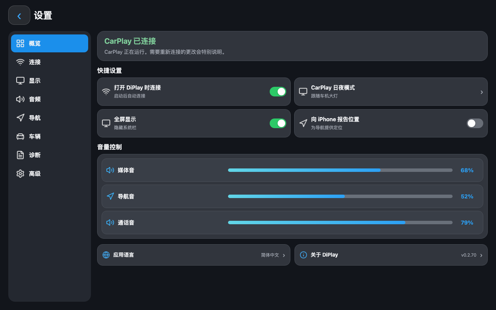
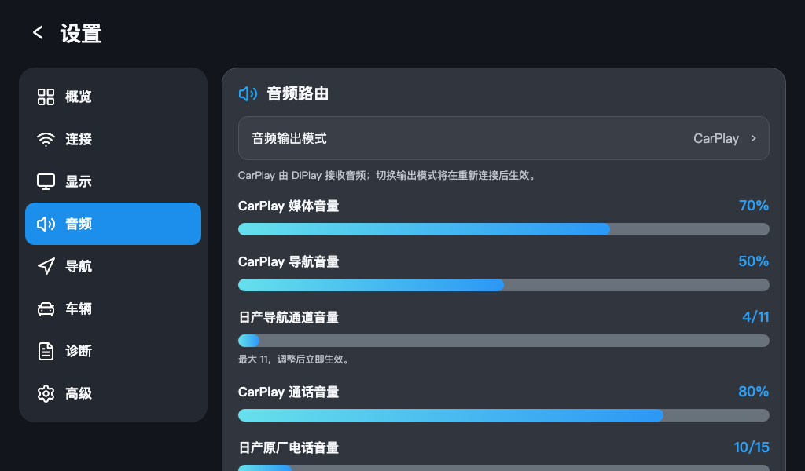
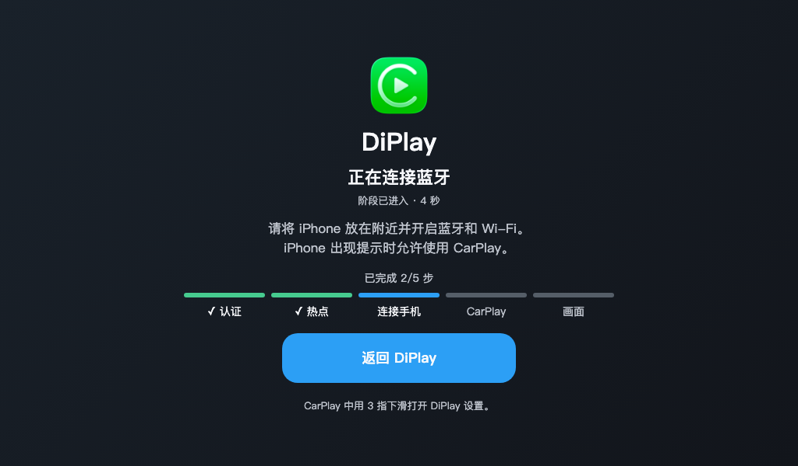
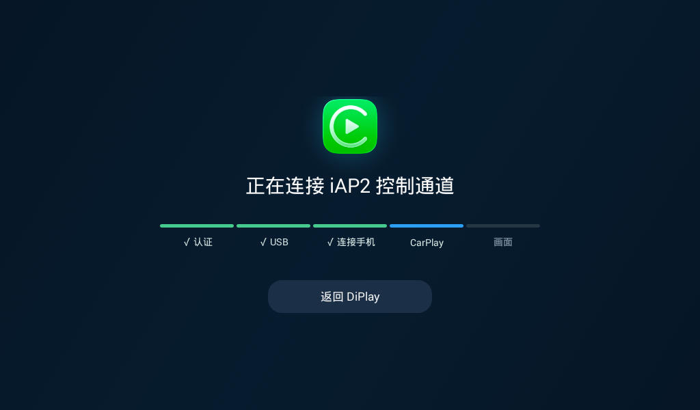

# DiPlay-Nissan

DiPlay-Nissan 基于 [DiPlay](https://github.com/shihabal3amri/DiPlay) 和 [DiPlay-Legacy-Android](https://github.com/programmerguohuajing/DiPlay-Legacy-Android)，专门为**日产 Android 4.4.3 车机**定制开发。当前主要适配 **2019 款日产逍客的 ARMv7 车机**，支持无线及 USB CarPlay 连接、本机音视频播放、方向盘媒体按键和诊断日志导出。CarPlay 导航、媒体和通话音量可分别调节；导航与媒体可分别选择车机音频通道，通话音频固定使用 Android 通话流 `0`。其他车机的兼容性尚未验证。

## 界面预览

以下预览展示当前设置总览、音频控制，以及应用运行时的连接页面：无线蓝牙阶段和 USB iAP2 控制通道阶段。设置总览中的连接状态、开关和音量值为示意，实际显示会跟随车机状态和用户设置。

| 设置总览 | 音频设置 |
|:---:|:---:|
|  |  |

| 无线连接 | USB 连接 |
|:---:|:---:|
|  |  |

项目名称为 DiPlay-Nissan；车机中显示的应用名称及发布的 APK 文件名使用 **DiPlay**。Android 包名保持不变，以支持覆盖安装。

## 版本与下载

- [GitHub Releases](https://github.com/BradyXs/DiPlay-Nissan/releases) 提供日产车机 APK、校验值、版本说明和源码归档。
- [项目页面](https://bradyxs.github.io/DiPlay-Nissan/) 介绍适配范围、安装和构建方式。

公开源码不包含 MFi 认证材料或 Android 签名私钥。Release 中的 APK 内含运行所需认证文件；公开下载意味着这些文件可从 APK 中提取。已有安装的覆盖升级要求包名与签名证书一致。请只安装适用于日产 Android 4.4.3 / ARMv7 的版本。

## 使用说明

### 首次连接

**无线 CarPlay**

1. 在日产车机的蓝牙设置中与 iPhone 配对，并确认车机和 iPhone 的 Wi-Fi 均已打开。
2. 打开 DiPlay，进入“设置 → 连接”，选择要连接的 iPhone，并按页面提示完成车机热点或现有 Wi-Fi 设置。
3. 回到 DiPlay 首页，点“无线连接”。解锁 iPhone，并接受 CarPlay 连接提示。

**USB CarPlay**

1. 使用支持数据传输的 USB 线，将 iPhone 接入车机 USB 数据口。
2. 在 DiPlay 首页点“有线连接”；如车机或 iPhone 出现 USB、信任或 CarPlay 提示，请允许连接。

### 设置与日常操作

- 点 DiPlay 首页的设置按钮，或在 CarPlay 画面使用默认三指下滑手势，可打开同一个设置页。左侧菜单切换连接、显示、音频、导航、车辆、诊断和高级设置。
- 设置概览提供“打开 DiPlay 时连接”、日夜模式、全屏和位置上报快捷项；日产宽屏布局还可直接调整媒体音、导航音和通话音。拖动滑条会立即生效；选中某一路音量滑条后，车机音量键可按 5% 步进调节该路。
- 要开机后自动连接，请进入“设置 → 连接”，启用开机连接并选择默认连接方式和 iPhone。“打开 DiPlay 时连接”只控制 DiPlay 启动后的自动连接。
- 连接方式在“设置 → 连接”调整；音频输出模式和车机音频通道在“设置 → 音频”调整。需要重新连接才能应用的选项会在设置页提示。
- 排查连接问题时，进入“设置 → 诊断”保存诊断报告。分享前请检查文件内容；报告不会自动上传。

## 方向盘按键

进入“设置 → 车辆 → 方向盘按键”，开启“日产实体按键”。功能支持切歌、电话和音量控制。首次启用或更改此开关后，如果按键没有生效，日产原厂服务可能需要重启车机后重新选择接收方；请在车辆停稳后操作。

## 构建

先安装[构建指南](docs/BUILD.md)列出的 JDK、Android SDK 和 NDK。构建不含认证材料的源码包：

```sh
ANDROID_HOME=/path/to/Android/Sdk sh ./gradlew \
  -PnissanAndroid44Profile=true \
  -PnissanAndroid44Abi=armeabi-v7a \
  :mobile:assembleDebug
```

可独立连接 CarPlay 的安装包需要自行提供本地认证材料，仓库不包含这些文件。具体步骤见[构建指南](docs/BUILD.md)和[安装说明](docs/INSTALL.md)。不要提交私钥、签名凭据或导出的诊断日志。

## 致谢与许可

感谢 [DiPlay](https://github.com/shihabal3amri/DiPlay) 和 [DiPlay-Legacy-Android](https://github.com/programmerguohuajing/DiPlay-Legacy-Android) 的开源工作，本项目在此基础上开发；也感谢 [xcertplay](https://github.com/shilapi/xcertplay) 提供接收端基础。设置界面包含改编自 [DiAuto](https://github.com/shihabal3amri/DiAuto) 的内容。

再分发时请保留原有版权及许可声明。详见 [LICENSE](LICENSE)、[第三方声明](docs/THIRD_PARTY_NOTICES.md)和保留的[上游说明](docs/UPSTREAM-README.zh-CN.md)。CarPlay 是 Apple 的商标；DiPlay-Nissan 是独立项目，未获 Apple 认证。
